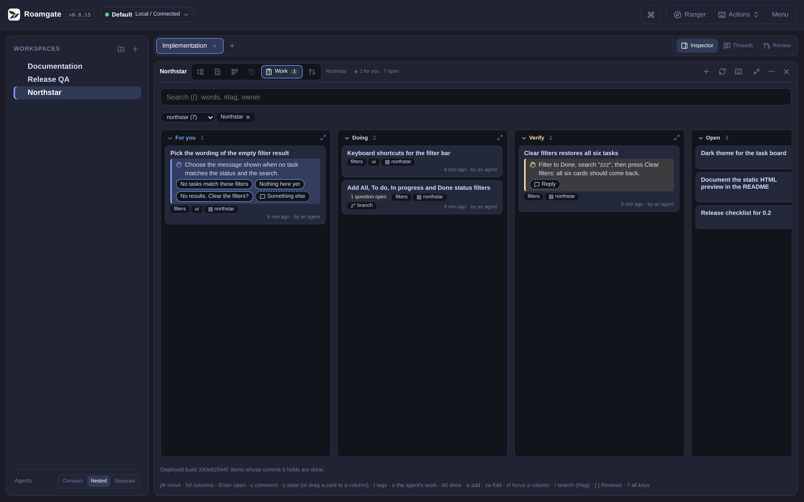
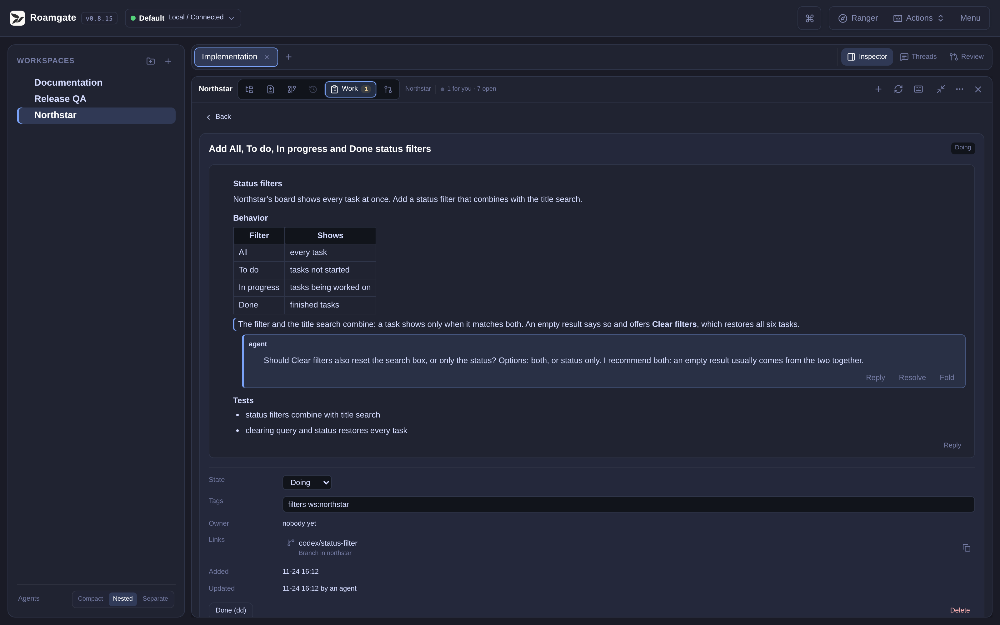
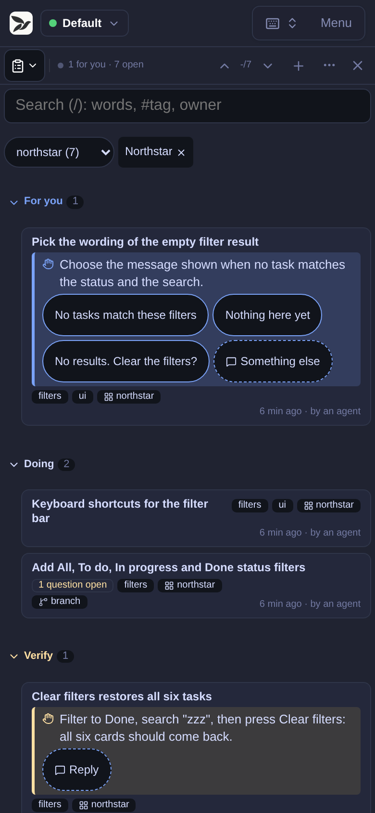
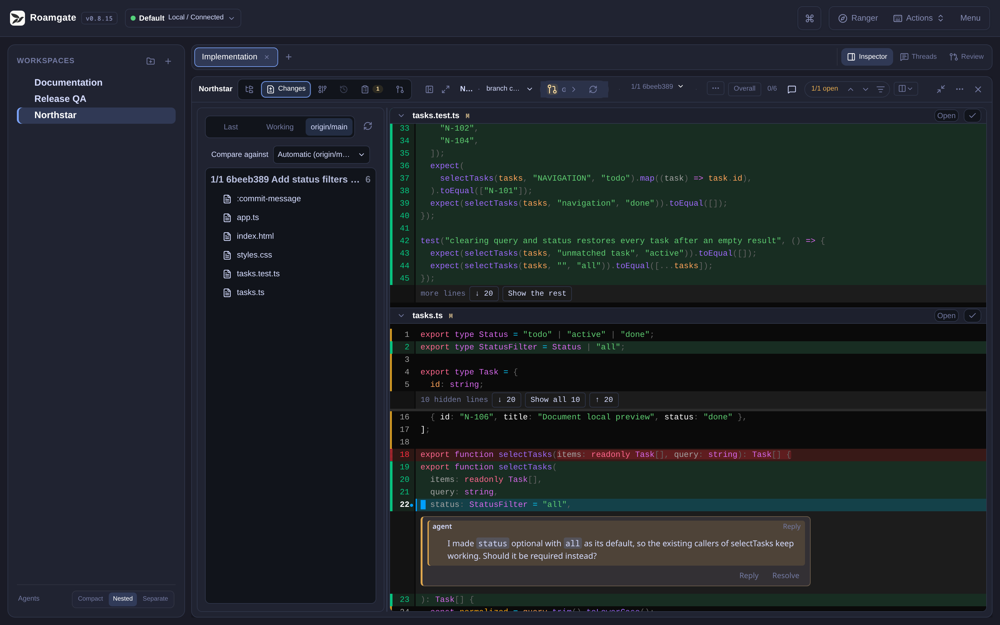
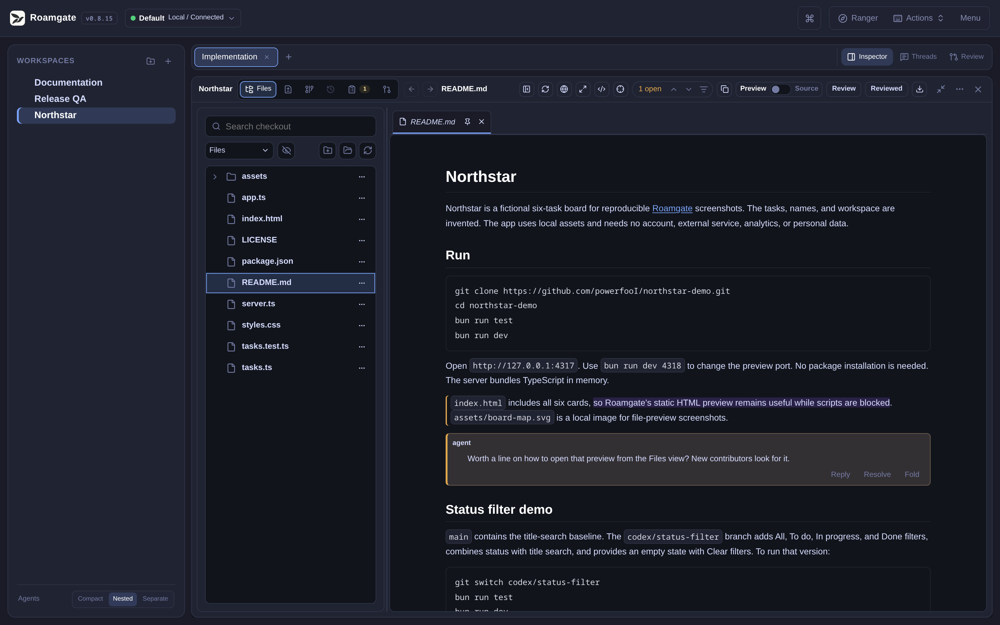

# Roamgate

<p align="center">
  <picture>
    <source media="(prefers-color-scheme: dark)" srcset="./site/assets/roamgate-lockup-on-charcoal.png" />
    
  </picture>
</p>

A **browser and PWA client** for [Herdr](https://herdr.dev) that brings your
workspaces, coding agent sessions, terminals, files, and code reviews into one
place. Check agent activity, inspect conversations, run commands, and review
diffs from your browser. Work on any computer, then continue from your phone
while Herdr keeps your sessions running.

**Requires a running Herdr server.** The machine Roamgate runs on needs
nothing but the release archive: the native `roamgate` binary, written in Rust
with the web app built in, and the bundled `roamgate-pi` helper Ranger uses for
models other than Claude Code. Linux/macOS hosts it reaches over SSH need
`python3` (standard library only) for agent features
([what an SSH host needs](docs/DEPLOYMENT.md#multiple-and-remote-herdr-connections)).

## Step away. Stay in flow.

Start on any computer. Leave Herdr running, then continue in the same workspace
from your phone.

[![Continue the same Herdr workspace from computer to phone with Roamgate][handoff-demo]][handoff-demo]

## Screenshots

### Desktop

A real Northstar demo workspace with code changes and passing tests.

<!-- markdownlint-disable MD033 -->

<table width="100%">
  <thead>
    <tr>
      <th width="33.33%" align="center">Workspace overview</th>
      <th width="33.33%" align="center">File explorer</th>
      <th width="33.33%" align="center">Diff annotations</th>
    </tr>
  </thead>
  <tbody>
    <tr>
      <td width="33.33%" align="center" valign="top">
        <a href="./docs/images/roamgate-desktop-changes.png"></a>
      </td>
      <td width="33.33%" align="center" valign="top">
        <a href="./docs/images/roamgate-desktop-files.png"></a>
      </td>
      <td width="33.33%" align="center" valign="top">
        <a href="./docs/images/roamgate-desktop-annotations.png"></a>
      </td>
    </tr>
  </tbody>
</table>

### Mobile

<table width="100%">
  <thead>
    <tr>
      <th width="33.33%" align="center">Code changes</th>
      <th width="33.33%" align="center">Terminal and tests</th>
      <th width="33.33%" align="center">HTML preview</th>
    </tr>
  </thead>
  <tbody>
    <tr>
      <td width="33.33%" align="center" valign="top">
        <a href="./docs/images/roamgate-mobile-changes.png"></a>
      </td>
      <td width="33.33%" align="center" valign="top">
        <a href="./docs/images/roamgate-mobile-terminal.png"></a>
      </td>
      <td width="33.33%" align="center" valign="top">
        <a href="./docs/images/roamgate-mobile-files.png"></a>
      </td>
    </tr>
  </tbody>
</table>

### Work board and reviews

Agents track their work on one board and discuss their changes with you, line
by line, in Roamgate's reviews.

<table width="100%">
  <thead>
    <tr>
      <th width="40%" align="center">Work board</th>
      <th width="40%" align="center">Design doc with a question</th>
      <th width="20%" align="center">Work on a phone</th>
    </tr>
  </thead>
  <tbody>
    <tr>
      <td width="40%" align="center" valign="top">
        <a href="./docs/images/roamgate-desktop-work.png"></a>
      </td>
      <td width="40%" align="center" valign="top">
        <a href="./docs/images/roamgate-desktop-work-item.png"></a>
      </td>
      <td width="20%" align="center" valign="top">
        <a href="./docs/images/roamgate-mobile-work.png"></a>
      </td>
    </tr>
  </tbody>
</table>

<table width="100%">
  <thead>
    <tr>
      <th width="50%" align="center">Branch review with the agent</th>
      <th width="50%" align="center">Comments on a rendered file</th>
    </tr>
  </thead>
  <tbody>
    <tr>
      <td width="50%" align="center" valign="top">
        <a href="./docs/images/roamgate-desktop-review.png"></a>
      </td>
      <td width="50%" align="center" valign="top">
        <a href="./docs/images/roamgate-desktop-rendered-comments.png"></a>
      </td>
    </tr>
  </tbody>
</table>

### Ranger

An experimental workspace management assistant for desktop and mobile.
Inspect workspace context, manage supported operations, and schedule background
checks. Requires Herdr and the Roamgate bridge to be running.

<table width="100%">
  <thead>
    <tr>
      <th width="75%" align="center">Desktop</th>
      <th width="25%" align="center">Mobile</th>
    </tr>
  </thead>
  <tbody>
    <tr>
      <td width="75%" align="center" valign="top">
        <a href="./docs/images/roamgate-desktop-ranger.png"></a>
      </td>
      <td width="25%" align="center" valign="top">
        <a href="./docs/images/roamgate-mobile-ranger.png"></a>
      </td>
    </tr>
  </tbody>
</table>

<!-- markdownlint-enable MD033 -->

Click any screenshot to open the full-resolution image.

[handoff-demo]: ./docs/images/roamgate-handoff.gif

> **Moving from Herdr Studio / herdr-gui?** Follow the
> [migration guide](./docs/DEPLOYMENT.md#transition-from-herdr-studio--herdr-gui);
> automatic upgrades are not supported.

## Quick start

1. Install and start [Herdr](https://herdr.dev), or let Roamgate do it later
   with `roamgate herdr setup`.
2. Install Roamgate on Linux or macOS (to pin a version, end the command with
   `| ROAMGATE_VERSION=X.Y.Z sh`):

   ```bash
   curl -fsSL \
     https://github.com/powerfooI/roamgate/releases/latest/download/install-roamgate.sh \
     | sh
   ```

   On Windows, download the x64 or ARM64 archive from the
   [latest release](https://github.com/powerfooI/roamgate/releases/latest).
3. Run `roamgate` (`roamgate.exe` on Windows; on Linux/macOS make sure
   `~/.local/bin` is on `PATH`) and open the printed URL. `roamgate url --qr`
   shows a QR code for your phone, and `roamgate doctor` diagnoses problems.

See [deployment](./docs/DEPLOYMENT.md) for configuration, services, and updates.

## Install as a PWA

**Recommended for daily use:** a separate app window without browser tabs or
the address bar. Log in to Roamgate, then install:
- **iPhone/iPad Safari:** Share -> Add to Home Screen.
- **macOS Safari 17+:** File -> Add to Dock.
- **Chrome/Edge:** browser menu -> Install app.

**A PWA is not offline access:** Roamgate must stay running and reachable.

## Documentation

- [Website](https://roamgate.dev/) and
  [hands-on tutorial](https://roamgate.dev/tutorial/)
  ([Markdown](./docs/TUTORIAL.md)): local work, mobile, and private remote access.
- [Features and shortcuts](./FEATURES.md)
- [Deployment](./docs/DEPLOYMENT.md): installation, configuration, services, builds.
- [Architecture](./docs/ARCHITECTURE.md): system contracts.
- [Security](./SECURITY.md) and [contributing](./CONTRIBUTING.md).

## Development

Use Bun 1.4.4 or newer, a stable Rust toolchain and a running Herdr server:

```bash
bun install --frozen-lockfile
bun run build:web
# Run in separate terminals:
bun run dev:server   # the Rust server, cargo run -p roamgate
bun run dev:web
```

Open <http://localhost:5173>. See [CONTRIBUTING.md](./CONTRIBUTING.md) for checks
and pull requests.

## Security

Roamgate controls terminals and real files. Normal runtime requires login, even
on loopback; only the loopback development server (`bun run dev:server`) skips
it. Keep the default loopback binding and read [SECURITY.md](./SECURITY.md)
before giving another device access.

## License

Code: [MIT](./LICENSE). Bundled fonts and brand assets retain their original
terms; see [THIRD_PARTY_NOTICES.md](./THIRD_PARTY_NOTICES.md).
